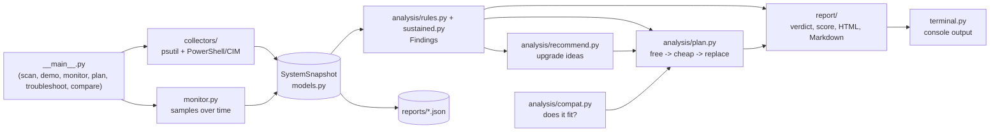

<!-- Added in v0.3.0 (Explained in v0.3.0): a plain-English tour of the code. -->
# How PC Diagnostics Toolkit works

This guide explains how the code fits together, why it was built this way,
and where to look when you want to change something. It assumes you know
basic Python (functions, classes, lists, dicts) but not the project.

## 1. The big picture

pcdiag reads facts about a Windows PC, turns them into plain-language findings,
and writes a report and an improvement plan. It is **advice only**: it never
changes settings, installs anything or makes network requests.

## 2. What happens when you run `python -m pcdiag scan`

1. `__main__.py` parses the arguments with `argparse` and calls `cmd_scan`.
2. If `--monitor S` was given, `monitor.py` first takes a reading every few
   seconds for S seconds. This happens *before* the scan because the scan
   starts PowerShell, which would show up as a fake CPU spike.
3. `collectors.collect_snapshot()` runs every collector in two thread pools:
   the sampling ones (CPU, disk I/O, processes) first, then the ones that
   launch PowerShell/powercfg/smartctl. The result is one `SystemSnapshot`.
4. `run_pipeline()` passes the snapshot through each stage, each one wrapped
   so a bug in one stage only prints a warning:
   `analyze` -> `recommend_upgrades` -> `verdict` -> `render_html`.
5. `build_plan()` turns findings and recommendations into the ordered plan.
6. `terminal.py` prints everything; the snapshot JSON and HTML report are
   saved in `reports/`.

`demo` does the same from a built-in example PC (`fixtures.py`), so you can
see a full report on any computer, including Linux CI.

## 3. Each module in plain English

| Module | What it does | Why it's built this way |
|---|---|---|
| `models.py` | Dataclasses for everything measured (CPU, memory, disks, battery, monitor samples...), with JSON save/load. | One shared "contract" between the layers. Units are in field names (`_gb`, `_percent`). Missing data is `None`, never 0. Old JSON files still load. |
| `collectors/*.py` | One file per area. Uses psutil for cross-platform numbers and PowerShell CIM queries for Windows-only details (RAM slots, drive health, driver dates, power plan). | psutil is a well-tested library that works on Windows and Linux, so the same code runs on CI. PowerShell fills the gaps psutil can't see. |
| `collectors/_shell.py` | The only place that runs external commands. | Timeouts, no console windows, no exceptions, and an easy place for tests to plug in fake output. |
| `monitor.py` | Takes readings every `--interval` seconds into a `MonitorSession`. | Lets the analysis tell a short spike from a PC that is always struggling. The clock, `sleep` and psutil can be swapped for fakes in tests. |
| `analysis/registry.py` | The `@rule` decorator and `analyze()`. | Plug-in pattern: adding a check means writing one function, not editing a big if/else. A crashing rule becomes an INFO finding instead of crashing the scan. |
| `analysis/rules.py` | The one-reading checks (RAM nearly full, disk almost full, HDD boot drive, old driver, hot CPU...). | Each rule is a *pure function*: snapshot in, findings out, nothing changed. Thresholds are named constants so they're easy to tune. |
| `analysis/sustained.py` | The over-time checks using monitor data (mean, p95, % of time above a threshold, longest streak, disk-filling trend). | A single reading can be misleading. A sustained finding replaces the single-reading one so nothing is reported twice. |
| `analysis/recommend.py` | Ranks hardware purchases by expected impact (data safety first, then SSD, RAM...). | Free fixes are never turned into purchases. |
| `analysis/compat.py` | Checks whether an upgrade can fit: soldered vs socketed RAM, max RAM, free slots, DIMM/SODIMM, DDR type, SATA/NVMe. | Answers are yes / no / can't tell. An upgrade that can't fit is never suggested. |
| `analysis/plan.py` | Builds "Your improvement plan": urgent, then free, then cheap, then replace. | Each step carries its evidence, cost range and confidence, so the advice can be checked. |
| `report/summary.py` | Verdict, 0-100 health score, metric cards, free fixes. | Shared by the HTML and Markdown reports so the two always agree. |
| `report/html.py`, `markdown.py` | Self-contained reports. | No external files or scripts; every value from the PC is HTML-escaped; status is never shown by colour alone. |
| `troubleshoot.py` | Step-by-step guides by symptom with stop points. | Marks which steps this PC's evidence points to. |
| `compare.py` | Diffs two saved snapshots. | Benchmark scores are only meaningful compared with earlier runs on the same PC. |

## 4. How the health score works

Start at 100 and subtract a penalty per finding: critical 35, warning 8,
info 1. Then clamp it into the band that matches the worst finding:

- any critical finding: at most 40 (red, "Action needed");
- any warning: between 41 and 79 (amber, "Needs attention");
- otherwise up to 100 (green, "Healthy").

Example: two warnings and three infos give 100 - 16 - 3 = 81, clamped to 79.
If core data is missing and nothing is wrong, the score is "unknown" rather
than a fake 100. Code: `health_score()` in `pcdiag/report/summary.py`.

## 5. Key design decisions and trade-offs

- **`None` means unknown.** A failed reading is never shown as 0 or "OK".
  Trade-off: more `if x is None` checks everywhere, but no false "healthy".
- **Never crash the scan.** Each collector and each pipeline stage is
  wrapped. Trade-off: bugs can hide in warnings, so they are printed on
  stderr and listed in `snapshot.errors`.
- **Rules of thumb, stated as such.** Thresholds (for example RAM above 90%)
  come from common IT-support practice, not vendor specs, and each finding has
  a confidence level.
- **Threads, not processes, for collection.** Collectors mostly wait, so
  threads overlap them cheaply. The benchmark is the exception: it uses
  multiprocessing because it needs real CPU work on every core.
- **Static prices.** Upgrade costs are ranges in USD (October 2026) so the
  tool works offline. Trade-off: they go out of date.
- **Images stored as text.** The NiyiSoft badge lives in
  `report/niyisoft_badge_data.py` as base64 so the package needs no data files.

## 6. How the tests are organised (330 tests)

- `tests/conftest.py` has the shared fixtures: `windows` (pretend to be on
  Windows and block real commands) and `ps_json` (fake PowerShell answers from
  `tests/data/`).
- Unit tests per layer: `test_models.py`, `test_collectors*.py`,
  `test_monitor.py`, `test_analysis.py`, `test_sustained.py`,
  `test_recommend.py`, `test_compat.py`, `test_plan.py`, `test_report.py`,
  `test_brand.py`.
- End-to-end tests: `test_cli.py` and `test_v030_cli_reports.py` run the real
  commands on the demo PCs and check the saved files.
- Run them with `python -m pytest -q`.
- **CI:** `.github/workflows/tests.yml` runs the suite on Windows and Ubuntu
  with Python 3.10 and 3.13 on every push, pull request and on the 1st of
  each month, then does a quick real scan as a smoke test.

## 7. Known limitations

- Windows first. On Linux/macOS you get the psutil data only.
- CPU temperature isn't exposed by Windows through psutil; pcdiag reads it from
  LibreHardwareMonitor when that app is running.
- An empty M.2 slot can't be detected (Windows doesn't report empty slots).
- Some checks need Administrator; without it they show "Can't tell".
- Crash history from the Event Log isn't read yet (planned for v0.5.0).
- Prices are static ranges, not live quotes.
- Benchmark scores are relative to this tool, not comparable with other
  benchmarks or other PCs.
- You need Python to run it until the planned Windows .exe.
